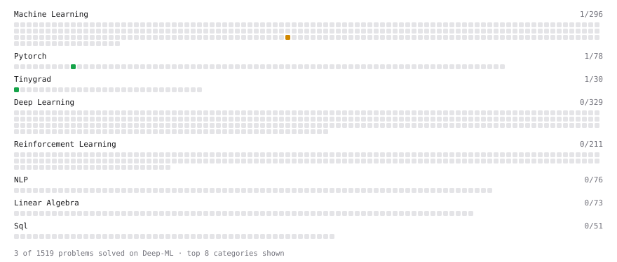

# Deep-ML

My machine learning practice from [Deep-ML](https://www.deep-ml.com). Every solution here was written by hand.

**2** solved · 2 problems · 0 labs · 0 math

[**Browse the interactive portfolio**](https://daemonX10.github.io/deep-ml/) to replay this filling in over time.

## Problems

| | Difficulty | Solved | |
| --- | --- | --- | --- |
| [Create a Float Tensor with Tinygrad](https://www.deep-ml.com/problems/889) | easy | 2026-05-14 | [solution](problems/0889-create-a-float-tensor-with-tinygrad) |
| [Train a Sparse Autoencoder on Residual-Stream Activations](https://www.deep-ml.com/problems/851) | medium | 2026-05-14 | [solution](problems/0851-train-a-sparse-autoencoder-on-residual-stream-activations) |

---

_This file is regenerated by Deep-ML on every push._
